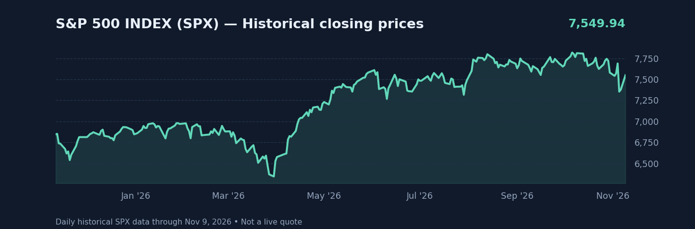

# SPX Market Analytics — Candlestick Viewer

An interactive chart of the **S&P 500 index (SPX / Yahoo symbol `^GSPC`)**, with real historical OHLC candles. This is **not Apple (AAPL), SPY, or an SPX CFD proxy**.

### [Open the interactive SPX candlestick viewer](https://market-analytics-lab.github.io/stock-market-analytics/)

## Chart controls

| Control | Available choices |
| --- | --- |
| Candle intervals | **1m, 5m, 15m, 1H, 4H, 1D, 1W, 1M** |
| Visible chart range | **1D, 5D, 1M, 3M, 6M, 1Y, ALL** |
| Chart style | Candlesticks or closing-price line |
| Indicators | 20-bar and 50-bar simple moving averages (SMA) |
| Navigation | Mouse-wheel/pinch zoom, drag/pan, crosshair, +/− zoom and fit-to-data |
| Additional | OHLC readout on hover, dark/light theme, fullscreen, range high/low |

Weekly/monthly candles are aggregated from **actual daily OHLC** bars. The 15-minute and 4-hour candles are aggregated from genuine intraday bars. No candle's opening price is guessed or filled from a previous close.

**Data coverage at this release (as of November 9, 2026):**

- ~500 daily bars (approximately 2 years); weekly/monthly from these daily bars.
- 3 trading sessions of 1-minute bars.
- 12 trading sessions of 5-minute bars (also used for 15-minute).
- 45 trading sessions of hourly bars (also used for 4-hour).
- The viewer automatically limits a selected time range to available source history when you request more history than exists for that interval.

The data is a **historical snapshot, not live streaming or licensed real-time SPX quotes**. Live data and the complete proprietary TradingView toolset are available on [the full TradingView SPX chart](https://www.tradingview.com/chart/?symbol=SP%3ASPX).

### Sources and charting

- OHLC source: Yahoo Finance S&P 500 index (`^GSPC`), using a publicly maintained [SPX market-data archive](https://github.com/Alexduanran/spx-0dte-archive). The project's `build_ohlc.py` fetch/validation logic was used to generate the data snapshot.
- Rendering: [TradingView Lightweight Charts](https://github.com/tradingview/lightweight-charts) 5.0.9. It is distinct from TradingView's proprietary Advanced Chart. © TradingView. The required TradingView attribution link is included in the viewer.
- Data generation uses true open, high, low and close observations and validates bar consistency. Intraday times are represented as US/Eastern-market timestamps.

## Files

| Path | Purpose |
| --- | --- |
| `index.html` | Dashboard, timeframe/range buttons, OHLC display |
| `styles.css` | Site layout |
| `chart.css`, `tv-chart.css` | Chart and responsive controls |
| `app.js` | Dark/light and fullscreen |
| `tv-chart.js` | Candlesticks, timeframe aggregation, moving averages and interaction |
| `spx-ohlc-data.js` | Historical daily and intraday SPX OHLC data snapshot |
| `build_ohlc.py` | Rebuild the OHLC data from the public ^GSPC archive (`python build_ohlc.py`) |
| `spx-preview.png` | README historical close preview |

The older `chart.js` and `spx-data.js` files remain in the repository as an earlier chart version, but they are no longer used by the live viewer.

## Hosting

GitHub Pages serves the site at https://market-analytics-lab.github.io/stock-market-analytics/ from the repository's `main` branch. There is no build step, API key, or server.

**Disclaimer:** Educational market research only. SPX cannot be purchased directly, and this site does not yet provide predictive models or trading recommendations.

## License

MIT — see [LICENSE](LICENSE). The TradingView Lightweight Charts library is separately licensed under Apache 2.0 and subject to its attribution requirements.
