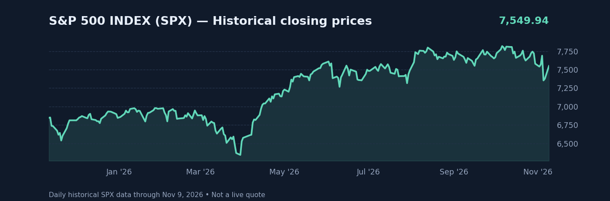

# SPX Market Analytics — Candlestick Viewer

An interactive chart of the **S&P 500 index (SPX / Yahoo symbol `^GSPC`)**, with actual recent OHLC candles **and monthly S&P Composite history back to January 1871**. This is **not Apple (AAPL), SPY, or an SPX CFD proxy**.

### [Open the interactive SPX historical and candlestick viewer](https://market-analytics-lab.github.io/stock-market-analytics/)

## Chart controls

| Control | Available choices |
| --- | --- |
| Candle intervals | **1m, 5m, 15m, 1H, 4H, 1D, 1W, 1M**; plus **1871+** monthly historical line |
| Visible chart range | **1D, 5D, 1M, 3M, 6M, 1Y, 5Y, 10Y, 25Y, 50Y, 100Y, ALL**. Long ranges and ALL open historical monthly data. |
| Chart style | Candles or closing-price line for real OHLC; line-only for 1871+ reconstructed monthly index levels |
| Indicators | 20-bar and 50-bar simple moving averages (SMA) |
| Navigation | Mouse-wheel/pinch zoom, drag/pan, crosshair, +/− zoom and fit-to-data |
| Additional | OHLC readout on recent bars, monthly-level readout in history, log/linear price scale, dark/light, fullscreen, range high/low |

Weekly/monthly candles are aggregated from **actual daily OHLC** bars. The 15-minute and 4-hour candles are aggregated from genuine intraday bars. No candle's opening price is guessed or filled from a previous close.

## Second chart: historical SPX candles and pattern exploration

The separate [SPX Candlestick Pattern Explorer](https://market-analytics-lab.github.io/stock-market-analytics/#candle-explorer) now includes **17,549 actual archived daily index records** from **March 4, 1957 through November 20, 2026** (automatically extended as the daily SPX feed updates). The normal 1871+ history remains a monthly index-level line on the main chart; no monthly observations are converted into synthetic candles.

### Historical OHLC coverage and accuracy

- **1957–December 2018**: Yahoo Finance daily S&P 500 history from [vijinho/sp500](https://github.com/vijinho/sp500), cross-checked for valid OHLC.
- **2018–November 2024 bridge**: separately downloaded authentic Yahoo `^GSPC` daily OHLC using an explicit date-range query. The historical archive has no multi-year missing segment.
- **November 2024 onward**: the repo's existing `^GSPC` daily updates, merged into the long archive by `refresh_spx_long.py` on the scheduled 3:30 PM America/Chicago workflow.
- **Data-quality limitation:** 1,255 older records report zero OHLC range. The earliest non-flat record in this dataset is January 2, 1962. Those older identical-value records are useful for price-level studies but **not** credible evidence of a zero wick. A separate line depicts legacy price levels where OHLC is flat; the explorer flags the data-quality issue.
- All historical bars are distinct dated observations; there is no price interpolation, inferring opening prices from prior closes, or guessing a missing high/low. Daily OHLC from public vendors is not an official licensed S&P index market feed and should be cross-validated for high-stakes research.

### How to find and label older highs and lows

1. Go to **SPX Candlestick Pattern Explorer**, beneath the main chart.
2. Choose **5Y**, **10Y**, **25Y**, **50Y**, or **ALL**; or enter a specific date under **Jump to Date**, press **Go**, and zoom/pan around it.
3. Choose the correct **dH, dL, JH, JL, RH, or RL** label, then enable **Click candle to label: On** and click the desired SPX trading-day candle.
4. Repeat as needed. Your starred labels appear on the chart and in the date list. They are saved **locally in the current browser**, not automatically uploaded to GitHub.
5. Click **Copy my dates** and paste the *dates* into your ChatGPT conversation to add them to the permanent model and analyze the older turning-point examples. There is no code to copy or install.

### Toggleable historical model guesses — **1962–1996**

The second chart now has a separate **Show model guesses: On/Off** control. It plots **retrospective pattern hypotheses** on genuine daily SPX observations between February 1962 and December 1996, **before any of the supplied 1997+ user labels**. Enabling the control navigates to 1987–1996 by default; the **View 1987–96** shortcut and **Jump to Date** input allow exploration of other years. The companion category filter can show dH, dL, JH, JL, RH, RL, all six, or the default **four moderate/major classes without the very small-sample bear classes**.

- Each proposed location is a **colored circle with a question mark**, such as `JL?` or `dH?`. It represents the **pattern trigger date**, *not* an observed, verified market high/low. The pattern's research target was an actual user-labeled close **one to three following trading sessions later**.
- Training/ranking rules are frozen using the 1997–2018 labels; the same rule functions are applied **backward** to daily 1962–1996 OHLC. Early OHLC with zero range and its surrounding seven-session context are excluded. This is **not** an out-of-sample test: the older dates precede the data used to choose these rules.
- For each label, the eight best earlier-trained candidate rules contribute votes. Five of eight votes (six of eight for RH/RL) are required before the fixed cooldown suppresses nearby overlaps. Correlated patterns can vote together; **vote count is not a probability**.
- Initial 2026-11-23 research archive: **380 total pre-1997 candidates** (dH 13, dL 163, JH 25, JL 90, RH 87, RL 2). **291** in the default dH/dL/JH/JL display. These counts are heavily skewed toward lows and must **not** be interpreted as established high/low turning points.
- Confirmed user turning-point arrows, browser-saved `*` annotations, and pre-1997 model guesses are rendered **at most once per trading day**, in that priority order. Selected individual pattern dots remain a separate toggle. Model guesses start **off** and never become permanent user annotations without deliberate labeling and sharing.

Use these candidate circles as suggested places to **inspect and manually label**, not as factual extrema or trade signals. In particular, the RH/RL rules are based on just two pre-2019 market cycles.

### Pattern model limitations and controls

The candlestick research archive now evaluates real SPX daily OHLC from **1962–2026**, with its supervised labeled discovery and holdout samples confined to **1997–2026**. Its first 1997 research labels came from the two collections of 162 user-supplied historical dates. Those records were added to the prior 13 labels, producing **175 distinct labeled SPX turning points** across six categories:

| Label | Interpretation | User-supplied examples |
|---|---|---:|
| dH | Moderate high | 63 |
| dL | Moderate low | 63 |
| JH | Major high | 22 |
| JL | Major low | 21 |
| RH | Bear-market high | 3 |
| RL | Bear-market low | 3 |

The user defines the turning-point types and dates; these are subjective **closing-price** event labels, not independently audited exact-extremum bars.

The offline generator `generate_spx_candle_report.cjs` tests **43,266 candidate wick/body/sequence conditions and combinations** from true daily OHLC. It trains on **5,533 candidate decision sessions during 1997–2018**, then evaluates the selected rules on **1,981 strictly later decision sessions (2019–2026)**. The three-session forward event horizon is separated from the training/holdout boundary by a three-session embargo. Outcomes from holdout sessions do **not** select, rank, or tune the training winners. The generator is rerun on label changes and on the existing daily SPX data refresh; browsers load the precomputed `spx-candle-report.js` rather than scanning 43,266 rules live.

### Model interpretation and bear-market classes

The chart displays each target's actual top-ranked candlestick rules, earlier training hits, later out-of-sample hits, and **distinct turns covered**. These results are recomputed from the latest permanent labels, not copied from an earlier report.

**Bear markets:** RH is recorded on March 24, 2000; October 9, 2007; and January 3, 2022. RL is recorded on October 9, 2002; March 9, 2009; and October 12, 2022. For **each** bear category, two earlier turning points are in the 1997–2018 training period and the 2022 example is in the later holdout. Candidate similarities are illustrative only: two training examples are **far too few for meaningful statistical calibration**. Rankings for RH/RL must be labeled very-small-sample, not validated predictions.

**One flag per date:** Permanent labels are deduplicated by date. In the second chart, dates already committed to GitHub supersede matching browser-local annotations and pattern dots. Browser-local duplicates are cleaned on load, and clicking an already permanently labeled candle does not add another flag. Pattern overlays are **off by default** and can be enabled by selecting a discovered rule.

"Winning sessions" count pattern days that preceded **a user-labeled event in one of the next three trading days**. Multiple winning sessions can refer to the same future turn; distinct turning points covered are separately reported. Tens of thousands of hypothesis combinations imply substantial overfitting risk, and no pattern here has a demonstrated real-time trading edge.

The second chart supports an independently switchable pre-1997 guess overlay, one selected purple training/holdout pattern overlay at a time, colored arrows for all 175 unique historical user labels, zoom, crosshair, logarithmic scale, and 1957+ date navigation. No 1871 monthly observations are treated as daily candlesticks; close-only/flat older bars are excluded from wick-based mining.

**No model here has a validated trading edge.** The number of searched hypotheses is enormous relative to labeled turning points. A historical training winner is not a forecast, and the holdout is intended to reveal failures as well as successes.

Validation: `node spx-candle-test.cjs` verifies report reproducibility and invariance of training winners when held-out prices are altered. `node spx-long-test.cjs` checks 1957+ daily index history.

## SPX turning-point research (experimental)

The viewer now has two separate studies:

1. **The original 13 recent turning-point timing examples** (`dH`, `dL`, `JH`, `JL`) and their fitted calendar-day watch windows, plus the newer 146 historical annotations for the independent candle-pattern study. Those windows are descriptive hypotheses fitted from a very small user-supplied sequence, not statistically calibrated probabilities.
2. **Independent multi-feature historical study**, implemented in `spx-pattern-engine.js`. This tests price/momentum/volatility/seasonality and fixed multi-year cycle features against reproducible **monthly-average** swing labels.

Click **Model backtest markers** to visualize purple `M-H` and `M-L` high-scoring OOS months. Their top-decile cutoff was established after ranking the entire held-out sample. They are **retrospective diagnostics**, not historically executable trade alerts. Leave that overlay off for a clean chart.

### Model methodology

- **Data**: reconstructed monthly S&P Composite/index averages from 1871 to the last complete month; never call them daily closing-price highs or daily OHLC candles.
- **Inputs (16 total)**: lagged log returns over 1/3/6/12 months, three-month momentum acceleration, level versus trailing average and range extrema, realized volatility at 6 and 12 months, a 14-change momentum oscillator, annual-seasonal sine/cosine, a pre-specified 48-month sine/cosine and a 96-month sine term.
- **Historical target**: moderate = local ±2-month average-price extremum followed by a ≥6% reversal within six months; major = local ±5-month extremum followed by a ≥16% reversal within 12 months. Major supersedes moderate. This is deliberately **not** a claim that the model recovers the user's 13 exact closing-price event dates.
- **Forecast**: separate regularized logistic models estimate whether a retrospectively defined dH/dL/JH/JL event occurs within the following **three months**.
- **Backtest**: expanding-window, five-year refits beginning January 1990 through August 2025. Models use older observations only; at least 15 months of outcome maturity/embargo are withheld from training. The baseline is the historical positive-event frequency from that training vintage.
- **Measurement**: Brier skill above 0 beats the vintage base-rate forecast; top-decile hit rate summarizes ranking, *not* trading profits. The small number of major events makes those estimates uncertain.
- **Regression test**: `node spx-pattern-test.cjs` checks syntax and reproduces earlier predictions after artificially truncating future history. GitHub Actions runs this on changed model files.

### Initial January 1990–August 2025 walk-forward results

**428 monthly predictions per class; 3-month prediction horizon**.

| Label | Outcomes / 428 | Overall event rate | Held-out top 10% hit rate | Top decile vs overall | Brier skill vs baseline |
|---|---:|---:|---:|---:|---:|
| dH moderate high | 45 | 10.5% | 8 / 43 (18.6%) | 1.77× | +1.69% |
| dL moderate low | 64 | 15.0% | 5 / 43 (11.6%) | 0.78× | −0.05% |
| JH major high | 15 | 3.5% | 0 / 43 (0.0%) | 0.00× | −1.13% |
| JL major low | 33 | 7.7% | 9 / 43 (20.9%) | 2.71× | +3.16% |

### Earlier-period robustness check: 1930–1989

The exact same model was also run as an earlier **720-month** expanding-window historical stress test. No changes to the price features or event labels were made between the two periods.

| Label | Event count | Top-scored 10% hit rate | Ranking lift | Brier skill |
|---|---:|---:|---:|---:|
| dH | 86 / 720 | 13 / 72 (18.1%) | 1.51× | −2.70% |
| dL | 92 / 720 | 11 / 72 (15.3%) | 1.20× | −1.31% |
| JH | 45 / 720 | 4 / 72 (5.6%) | 0.89× | −0.81% |
| JL | 72 / 720 | 16 / 72 (22.2%) | 2.22× | −0.03% |

All four Brier skill results were nonpositive in the older era. The JL ranking persisted, but **this does not validate accurate probabilities**. These earlier years are reconstructed monthly averages.

**Interpretation**: the early study suggests some ranking usefulness for major lows, but the Brier improvement is small and the major-high model has not demonstrated an edge. All probabilities remain experimental; the 13 hand-supplied dates were not used to optimize these tests. There is no evidence here of a profitable strategy or a reliable exact-date prediction.

### Independent VIX and breadth evidence

- `spx-vix-data.js`: historical month-end **VIX** closes starting 1990; initial archive from [datasets/finance-vix](https://github.com/datasets/finance-vix), originally sourced from [Cboe](https://www.cboe.com/tradable_products/vix/vix_historical_data). The daily workflow attempts an official Cboe refresh. An independent analysis in `spx-pattern-context.js` reports next-three-month pivot frequencies conditional on the **preceding 60 months' VIX quartiles**. This is descriptive, not an independently trained backtest and not part of the 1871 model.
- `spx-breadth-data.js`: dated advances, declines and a 20-session A/D comparison from [DeanFinancials current-constituent S&P 500 archive](https://github.com/DeanFinancials/deanfi-data). Its roughly two-year archive and changing/modern stock membership can create **survivorship/selection bias**. Treat it as short-term context only; it cannot validate 1871-era breadth.
- The dashboard labels the *date of the last available observation* for all external sources. Missing or stale feeds are not replaced with synthetic values. The regular **3:30 p.m. America/Chicago** workflow includes these feeds while preserving prior data when retrieval fails.

### Historical series: January 1871 onward

Use **1871+** in the chart-interval row, or **ALL / 5Y / 10Y / 25Y / 50Y / 100Y** in the visible-range row. The long-horizon chart switches to a **logarithmic monthly line** by default. Click **Log Scale** to switch between logarithmic and linear.

The **S&P 500 in its modern form launched March 4, 1957**. Before that date the chart presents Robert Shiller's **reconstructed monthly S&P Composite** data; it is not a literal SPX trading history and does **not** supply candle opens, intramonth highs, intramonth lows, or closing values. The monthly values are index observations/averages. Range high and low in historical mode refer to the highest/lowest **monthly reported level**, not intramonth peaks and troughs. The series is price-only, not dividend-inclusive or inflation-adjusted.

- **January 1871 – September 2026:** monthly SP500 series in [datasets/s-and-p-500](https://github.com/datasets/s-and-p-500), compiled from [Robert Shiller's monthly data](https://shillerdata.com/) and extended more recently with the Federal Reserve's monthly S&P 500 series.
- **October 2026 onward:** arithmetic averages of actual daily ^GSPC closes in the repository's refreshed data. The current month is flagged as provisional until the next month has trading observations. No OHLC candles are inferred from monthly averages.

When selecting recent candles, the viewer shows real OHLC (where available) and returns to a linear scale by default. Clicking **Candles** from the historical line switches back to 1D candles.

**Recent OHLC coverage in the initial November 9, 2026 snapshot (automatically advanced as newer bars become available):**

- ~500 daily bars (approximately 2 years); weekly/monthly from these daily bars.
- 3 trading sessions of 1-minute bars.
- 12 trading sessions of 5-minute bars (also used for 15-minute).
- 45 trading sessions of hourly bars (also used for 4-hour).
- The viewer automatically limits a selected time range to available source history when you request more history than exists for that interval.

The data is a **daily updated snapshot, not live streaming or licensed real-time SPX quotes**. Live data and the complete proprietary TradingView toolset are available on [the full TradingView SPX chart](https://www.tradingview.com/chart/?symbol=SP%3ASPX).

### Sources and charting

- OHLC source: Yahoo Finance S&P 500 index (`^GSPC`), using the Yahoo Chart API for fresh post-close daily/intraday bars, with a publicly maintained [SPX market-data archive](https://github.com/Alexduanran/spx-0dte-archive) as a daily fallback. `build_ohlc.py` supplies quote validation and the archive parser. New bars are never invented.
- Rendering: [TradingView Lightweight Charts](https://github.com/tradingview/lightweight-charts) 5.0.9. It is distinct from TradingView's proprietary Advanced Chart. © TradingView. The required TradingView attribution link is included in the viewer.
- Data generation uses true open, high, low and close observations and validates bar consistency. Intraday times are represented as US/Eastern-market timestamps.

## Automatic daily refresh

- **When:** Every day at **3:30 p.m. America/Chicago (Central Time)**, using a time-zone-aware GitHub Actions schedule that follows daylight saving time.
- **What:** The workflow fetches genuine Yahoo ^GSPC daily OHLC, attempts the recent 1-minute, 5-minute and hourly snapshots, and preserves validated existing bars when a source is temporarily unavailable. It updates the reconstructed historical chart's latest monthly average using actual daily closes.
- **Publishing:** Only when fresh daily bars arrive, the workflow commits updated datasets and a date-versioned HTML reference to `main`, then explicitly requests a GitHub Pages rebuild. Data files are versioned in HTML to prevent stale browser-cache data.
- **No market session:** Weekends and holidays typically produce no new price observations and therefore no chart data commit.
- **Timing is best-effort:** GitHub may start scheduled jobs late and Yahoo's data may not be available at exactly 3:30 p.m. The viewer shows each series' latest source date; it is not real-time.
- **Manual run:** Go to the repository's **Actions** tab → **Refresh SPX chart at 3:30 PM Central** → **Run workflow**. Offline tests run before the dataset changes.

## Files

| Path | Purpose |
| --- | --- |
| `index.html` | Dashboard, timeframe/range buttons, OHLC display |
| `styles.css` | Site layout |
| `chart.css`, `tv-chart.css` | Chart and responsive controls |
| `app.js` | Dark/light and fullscreen |
| `tv-chart.js` | Recent candles, historical monthly line, timeframe aggregation, scales, moving averages and interaction |
| `spx-ohlc-data.js` | Recent daily and intraday SPX OHLC data snapshot |
| `spx-history-data.js` | 1,871 reconstructed/monthly S&P Composite and S&P 500 observations, January 1871 onward |
| `build_ohlc.py` | Validate SPX data and parse historical archive fallback |
| `refresh_spx.py` | Fetch current OHLC, extend daily candles, and maintain the monthly historical series |
| `refresh_spx_test.py` | Offline regression tests for the refresher |
| `.github/workflows/refresh-spx.yml` | Daily 3:30 p.m. Central GitHub Actions schedule and GitHub Pages rebuild |
| `spx-preview.png` | README historical close preview |

The older `chart.js` and `spx-data.js` files remain in the repository as an earlier chart version, but they are no longer used by the live viewer.

## Hosting

GitHub Pages serves the site at https://market-analytics-lab.github.io/stock-market-analytics/ from the repository's `main` branch. The daily job explicitly requests GitHub Pages to rebuild after a data commit; no external API key or hosted server is required.

**Disclaimer:** Educational market research only. SPX cannot be purchased directly, and this site does not yet provide predictive models or trading recommendations.

## License

MIT — see [LICENSE](LICENSE). The TradingView Lightweight Charts library is separately licensed under Apache 2.0 and subject to its attribution requirements.
